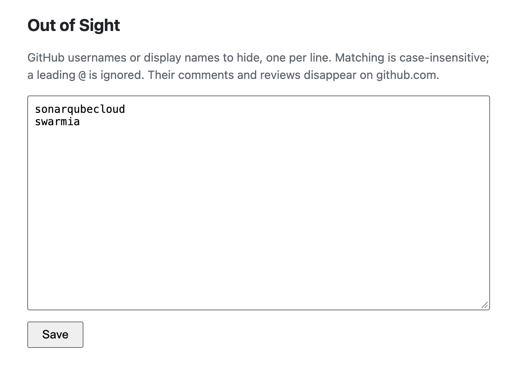
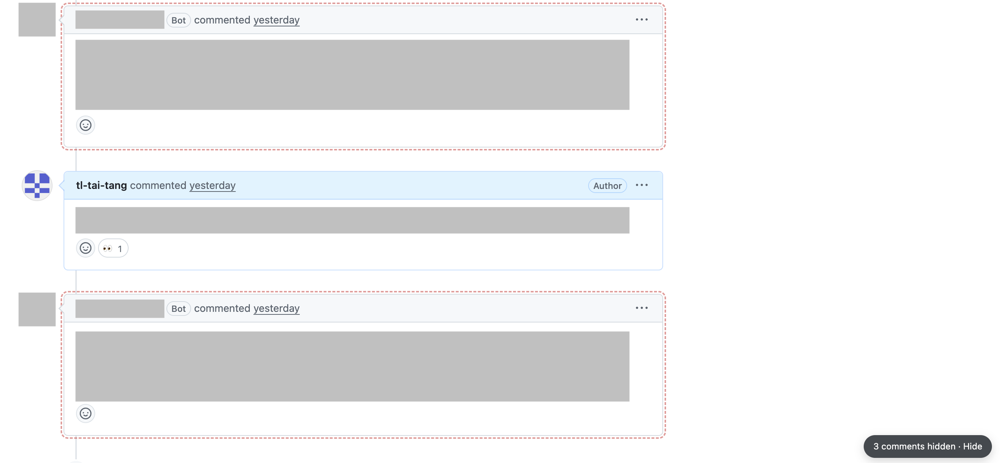

<p align="center">
  
</p>

<h1 align="center">Out of Sight</h1>

<p align="center">A Chrome extension that hides GitHub comments and reviews from users you choose — noisy bots, chatty reviewers, anyone.</p>

## Features

- **Hide by username or display name** — matching is case-insensitive and a leading `@` is ignored.
- **Removes comments completely** — issue/PR comments, inline review comments, and whole reviews (including "approved" / "requested changes" entries). Threads left empty disappear too.
- **Leaves the rest alone** — `@mentions` of a hidden user, their commits, and the sidebar are untouched.
- **Hidden-count badge** — a small pill in the bottom-right corner shows how many comments are hidden on the page. Click it to reveal them (outlined in red) and click again to hide.
- **Live updates** — works with GitHub's in-page navigation and applies changes to the list immediately.

## Screenshots

### Settings page

Add one username or display name per line, then click **Save**.



### Reveal hidden comments

Click the `N comments hidden` badge to temporarily show hidden comments. They are outlined so you can tell them apart. Click **Hide** to remove them again.



## Installation

Out of Sight isn't on the Chrome Web Store; load it as an unpacked extension. Works in Chrome and other Chromium browsers (Edge, Brave, Arc).

### 1. Get the code

```bash
git clone https://github.com/tl-tai-tang/out-of-sight-chrome-plugin.git
```

Or download the repository as a ZIP from GitHub (**Code → Download ZIP**) and unzip it.

### 2. Load the extension

1. Open `chrome://extensions` in the address bar.
2. Turn on **Developer mode** (toggle, top-right).
3. Click **Load unpacked**.
4. Select the `out-of-sight-chrome-plugin` folder (the one containing `manifest.json`).
5. Optional: click the puzzle-piece icon in the toolbar and pin **Out of Sight**.

### 3. Add users to hide

1. Click the Out of Sight toolbar icon (or **Details → Extension options** in `chrome://extensions`).
2. Enter one GitHub username or display name per line, e.g. `octocat` or `some-app[bot]`.
3. Click **Save**. Open GitHub tabs update immediately.

The list syncs to other devices signed into the same Chrome profile (`chrome.storage.sync`).

### Updating

```bash
cd out-of-sight-chrome-plugin
git pull
```

Then click the reload icon on Out of Sight in `chrome://extensions` and refresh open GitHub tabs.

### Uninstalling

Click **Remove** on Out of Sight in `chrome://extensions`.

## How it works

| File | Purpose |
| --- | --- |
| `manifest.json` | Manifest V3 config; content script runs on `https://github.com/*` |
| `content.js` / `content.css` | Finds comment authors, hides matching comments, renders the badge |
| `options.html` / `options.js` | Settings page; list saved in `chrome.storage.sync` |
| `background.js` | Opens the settings page when the toolbar icon is clicked |
| `icons/` | Logo source (`icon.svg`) and PNG sizes |

## Limitations

- Relies on GitHub's page markup, so a GitHub UI change may require selector updates in `content.js`.
- Display names only match where GitHub renders them; most views show the login, so prefer usernames.
